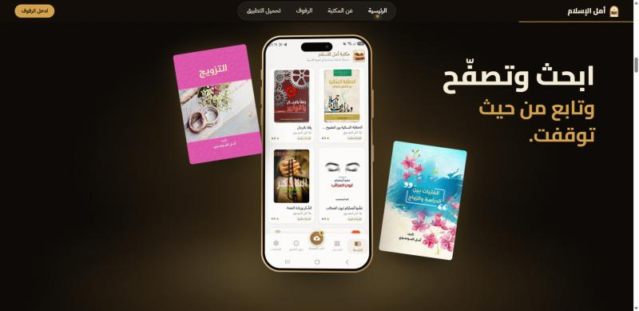
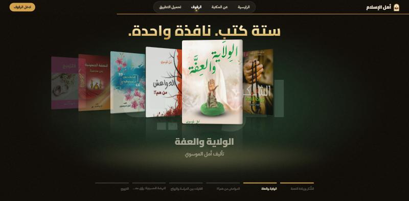
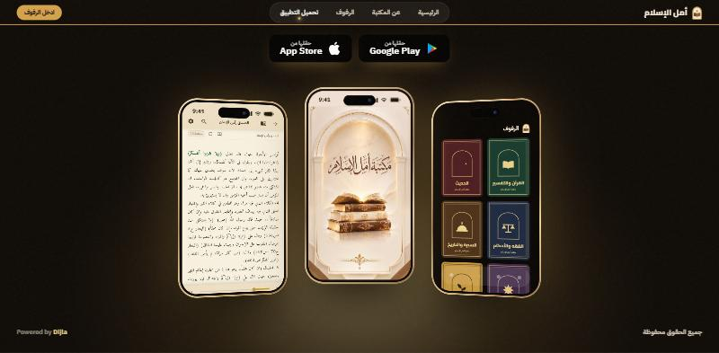

<div align="center">


# مكتبة أمل الإسلام
### Amal al-Islam Library — Landing Page

**كتابٌ واحد. نافذةٌ إلى النور.**
*One book. One window to the light.*

<br/>


</div>

<br/>

<p align="center">
  
</p>

---

## ✨ نظرة عامة · Overview

صفحة هبوط حديثة وفاخرة لتطبيق **مكتبة أمل الإسلام**، مبنية بالكامل بـ **React** وبحركات متصلة بالاسكرول. تعرض التطبيق داخل هاتف ثلاثي الأبعاد بشاشاته الحقيقية، وتستعرض الكتب في «كوفر فلو» تتحرك مع التمرير، وتنتهي بكتلة تحميل التطبيق.

A premium, scroll-driven landing page for the **Amal al-Islam** Islamic library app. It showcases the real app screens inside a tilted 3D iPhone mockup, a scroll-linked cover-flow of real book covers, and a download section.

> الصفحة بالكامل **عربية ومن اليمين إلى اليسار (RTL)**.

---

## 🎬 ما الذي ستجده · Highlights

| | |
| --- | --- |
| 📱 **هاتف iPhone ثلاثي الأبعاد** | إطار معدني ذهبي، جزيرة ديناميكية، أزرار جانبية، وانعكاس زجاجي يتحرك مع التمرير. |
| 🖼️ **شاشات التطبيق الحقيقية** | ست شاشات (الغلاف، الرئيسية، صفحة الكتاب، القراءة، الإعدادات، عن التطبيق) تتبدّل بالاسكرول. |
| 🧊 **بطاقات عائمة بعمق** | بطاقات زجاجية وأغلفة كتب تطفو حول الهاتف وتختلف في كل مرحلة. |
| 📚 **كوفر فلو متصل بالاسكرول** | ست أغلفة حقيقية، توهّج بلون كل غلاف، كلمة ضخمة خلف الكتاب، وشريط تقدّم قابل للضغط. |
| 🧭 **ناف بار زجاجي** | كبسولة روابط بحركة «الكلمة تدور» وإضاءة تتبع المؤشر ونقطة ذهبية تنزلق بين الأقسام. |
| 🍎 **كتلة تحميل التطبيق** | أزرار Google Play وApp Store وزر «تصفح المكتبة»، مع ثلاثة هواتف تنفتح بالاسكرول. |
| 🌗 **تحميل سلس للصور** | تظهر نسخة مموّهة أولاً ثم تتضح الصورة الحادة (blur-up). |
| ♿ **يحترم تقليل الحركة** | يعمل `prefers-reduced-motion` بتبسيط الحركات. |

<br/>

<table>
  <tr>
    <td width="50%"></td>
    <td width="50%"></td>
  </tr>
  <tr>
    <td align="center"><sub>كوفر فلو الأغلفة</sub></td>
    <td align="center"><sub>كتلة تحميل التطبيق</sub></td>
  </tr>
</table>

---

## 🧰 التقنيات · Tech Stack

- **[React 18](https://react.dev)** + **[Vite 5](https://vitejs.dev)**
- **[Framer Motion](https://www.framer.com/motion/)** — حركات مرتبطة بالاسكرول (`useScroll` / `useTransform`)
- **[Lenis](https://lenis.darkroom.engineering)** — اسكرول ناعم
- **CSS** نقي (متغيّرات، `clip-path`، `perspective`، `backdrop-filter`) بدون مكتبات UI
- **الخطوط:** Cairo (العناوين) · IBM Plex Sans Arabic (النصوص) · Aref Ruqaa (الخط الخطّي)

---

## 🚀 التشغيل · Getting Started

```bash
# 1) clone
git clone https://github.com/malkeahmed/Amal-al-Islam.git
cd Amal-al-Islam

# 2) install
npm install

# 3) run in development
npm run dev
```

ثم افتح `http://localhost:5173`.

| الأمر | الوظيفة |
| --- | --- |
| `npm run dev` | تشغيل خادم التطوير |
| `npm run build` | بناء نسخة الإنتاج في `dist/` |
| `npm run preview` | معاينة نسخة الإنتاج محلياً |

---

## 🗂️ هيكل المشروع · Project Structure

```text
Amal-al-Islam/
├─ index.html            # الصفحة + تحميل الخطوط (lang="ar" dir="rtl")
├─ vite.config.js
├─ public/
│  ├─ brand.webp         # شعار التطبيق
│  └─ img/               # الأغلفة، لقطات التطبيق، صور المخطوطات
├─ src/
│  ├─ main.jsx
│  ├─ App.jsx            # كل الأقسام والمكوّنات
│  ├─ shots.js           # لقطات التطبيق + معاينات التمويه
│  └─ styles.css         # التصميم
└─ docs/                 # صور المعاينة لهذا الملف
```

أقسام الصفحة (بالترتيب): **الهيرو** ← **عن المكتبة** ← **الكتب** ← **تحميل التطبيق**.

---

## ⚙️ التخصيص · Customization

### روابط المتاجر
افتح `src/App.jsx` وعدّل الثوابت التالية بالروابط الحقيقية:

```js
const PLAY_URL = '#'      // Google Play
const APPSTORE_URL = '#'  // App Store
const WEB_URL = '#'       // زر «تصفح المكتبة»
```

### استبدال شاشات التطبيق
ضع لقطاتك في `public/img/` وحدّث `src/shots.js` (المسار + صورة تمويه صغيرة). الأبعاد المثالية **923×2000** أو أي نسبة قريبة من ٩:١٩٫٥.

### الأغلفة
تُعرَّف في مصفوفة `BOOKS` داخل `src/App.jsx` (الاسم، الصورة، لون التوهّج، الكلمة الكبيرة خلف الغلاف).

### الألوان
متغيّرات `:root` في `src/styles.css` (`--gold`, `--deep`, `--cream` …).

---

## 🖼️ الصور · Image Credits

صور المخطوطات من **ويكيميديا كومنز**: مصحف جامعة برمنغهام (ملكية عامة) وصفحات الشاهنامة من متحف المتروبوليتان (CC0). أغلفة الكتب ولقطات التطبيق ملك أصحابها.

---

<div align="center">

جميع الحقوق محفوظة · All rights reserved

**Powered by Dijla**

</div>
